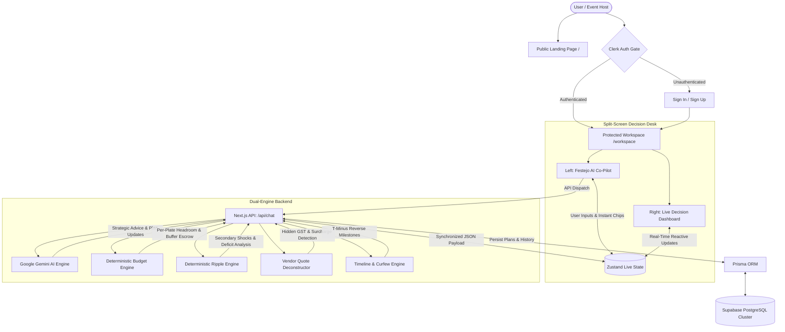

# Festejo AI : The Indian Event Decision Engine

**Prompt Wars Challenge 5 Submission**  
A Hybrid Deterministic + Generative AI SaaS Decision Engine for Indian Events.

---

## 1. Executive Summary and Positioning

Standard event-planning AI prompts typically default to generic lists, produce arithmetic hallucinations, and fail to anticipate the operational, regulatory, and cultural realities of Indian weddings and social celebrations. 

**Festejo AI** replaces hallucinated estimates with an authoritative **State-Aware Decision Engine**. Built for **Prompt Wars Challenge 5**, it pairs Google Gemini generative intelligence with deterministic TypeScript calculation modules to enforce strict unit economics, statutory buffers, and upstream-to-downstream ripple simulations.

### The Hybrid Architecture Advantage
- **Generative AI Tier (Google Gemini 1.5 Flash):** Natural language negotiation, context intake, cultural advisory, vendor quote inspection, and dynamic parameter parsing.
- **Deterministic Calculation Tier (TypeScript):** Zero-hallucination per-plate calculations, mandatory 10% contingency escrow quarantining, reverse timeline critical path mapping, and mathematical trade-off resolution.
- **Zero Hallucination Guarantee:** Math is never entrusted to the LLM. Every rupee, plate ratio, and timeline dependency is calculated deterministically before being rendered in the live ledger.

---

## 2. System Architecture

The diagram below illustrates the end-to-end data flow between the user interface, authentication gateway, deterministic calculation engines, Google Gemini AI, and persistent database storage:



---

## 3. The 4-Stage Operational Decision Flow

The application executes through four distinct operational stages to prevent ambiguous or unvalidated planning:


### Stage 1: Smart Context Intake (Discovery Gatekeeper)
Prevents premature plan generation by gathering four mandatory high-impact variables:
1. **Event Type:** Wedding, Sangeet, Reception, Corporate Gala, Anniversary.
2. **City and Tier Classification:** Tier 1 (Mumbai, Delhi NCR, Bengaluru), Tier 2 (Jaipur, Lucknow, Chandigarh, Pune), or Tier 3.
3. **Date and Season:** Winter auspicious dates (Saya season), Monsoon, or Summer heat-dome windows.
4. **Guest Count and Total Budget Ceiling:** Establishes the hard financial ceiling.

### Stage 2: Budget Stress-Testing (Per-Plate Reverse Economics)
Calculates feasibility by deducting essential overheads before allocating catering funds:
- **10% Statutory Reserve Escrow:** Quarantines exactly 10% of total budget into escrow for power generators, society NOCs, and weatherproofing.
- **Venue and Logistics Deduction:** Standardized benchmark allocation by city tier.
- **Maximum Per-Plate Headroom Formula:**
  ```
  Usable Pool = Total Budget - 10% Reserve Escrow - Venue Allocation
  Max Per-Plate Allowance = Usable Pool / Headcount
  ```
- **Deficit and Feasibility Alerts:** If the derived per-plate rate falls below city minimums (e.g. Rs. 2,500 in Tier-1), the system generates an immediate trade-off prompt.

### Stage 3: Operational Reverse Timeline and Cultural Guardrails
Calculates backward from key event milestones to enforce Indian statutory regulations:
- **10:00 PM Supreme Court Sound Curfew:** Strict outdoor sound cutoff. Baarat must cross the venue threshold by 8:30 PM to guarantee Varmala by 9:15 PM and DJ shutdown by 9:55 PM.
- **80-10 Floating Plate Rule:** For an invitation list of 500 guests, guarantees catering for 400 plates (80%), holds 50 plates in on-demand buffer (10%), and manages the remaining 10% float to eliminate food wastage.
- **Critical Path Flagging:** Any delay in Baarat progression triggers visual warnings for dinner hall transitions.

### Stage 4: Vendor Quote Deconstruction (The Trap Detector)
Normalizes and compares competing vendor quotations to prevent hidden cost creep:
- **18% GST Omission Detection:** Flags vendors who quote net prices while concealing statutory 18% GST until final invoice settlement.
- **Diesel Generator and Power Logistics:** Uncovers fuel clauses, cabling surcharges, and sound setup extras.
- **Corkage and Food Float Surcharges:** Identifies punitive overage rates when guest attendance exceeds baseline estimates.

---

## 4. How to Use Festejo AI : Step-by-Step User Guide

Festejo AI is designed to guide hosts and event planners through high-stakes decision making without spreadsheets or guesswork. Here is the operational walkthrough:

### Step 1: Access the Authenticated Decision Desk
1. Navigate to the landing page at `/` to review the architectural features and value proposition.
2. Click **Launch Workspace** or **Sign In** in the top navigation bar.
3. Authenticate securely via Clerk. Unauthenticated attempts to access `/workspace` are automatically redirected to the secure login modal.
4. Upon authentication, you enter the split-screen **Decision Desk**: the left panel houses your **Gemini AI Co-Pilot & Quick Action Bar**, while the right panel displays the reactive **Live Decision Dashboard**.

### Step 2: Configure Context Intake (Discovery Gatekeeper)
1. In the header bar or through the interactive Co-Pilot, confirm or update your core event parameters:
   - **City / Market:** Select Tier-1 (Delhi NCR, Mumbai, Bengaluru), Tier-2 (Jaipur, Lucknow, Chandigarh), or Tier-3.
   - **Guest Count:** Total expected attendees (e.g. 300 guests).
   - **Total Budget:** Total financial capital committed (e.g. Rs. 25,00,000).
   - **Event Type:** Wedding, Sangeet, Reception, Haldi, or Corporate Gala.
   - **Event Date:** Scheduled event date for reverse dependency countdowns.
2. Click **Run Stress Test** to recalculate the baseline plan.

### Step 3: Inspect the Live Decision Ledger
1. Observe the **10% Statutory Reserve Escrow** card at the top of the dashboard. Notice that 10% of your total budget (e.g. Rs. 2,50,000) is immediately locked away from vendor commitments.
2. Review the **Derived Max Per-Plate Allowance**. If your budget per plate is below the market benchmark for your city tier (e.g. < Rs. 2,500 in Tier-1), a bold amber warning identifies the exact financial deficit.
3. Examine the categorized budget ledger (Catering, Venue, Decor, Photography, Sound, Permissions, Reserve). Verify that the ledger reconciles to exactly 100% of your committed capital.

### Step 4: Simulate Shocks and Downstream Ripples
1. Use the **Quick Simulation Chips** in the AI Co-Pilot or click **Simulate Shock** in the dashboard:
   - **Guest Surge (+50 Guests):** Instantly recalculates extra catering plates, additional table seating, extra valet attendants, and shows how much of your 10% contingency escrow is absorbed.
   - **Venue Cost Escalation (+15%):** Demonstrates downstream trade-offs required to keep the total budget intact.
   - **Monsoon Weather Contingency:** Adds waterproof German hanger canopy overheads and power backup reserves.
2. When the contingency reserve is exhausted or budget is breached, click the **Apply Trade-Off** action chips (e.g. "Cap Guest Count", "Scale Back Decor", or "Acknowledge Deficit") to rebalance the ledger with a single click.

### Step 5: Deconstruct Competing Vendor Quotations
1. Click the **Vendor Matrix & Quote Deconstruction** tab in the dashboard or click **Compare Quotes**.
2. Compare side-by-side proposals (Quote A vs Quote B):
   - Review base quoted amounts against true effective totals.
   - Inspect the **Hidden Cost Trap Detector** for omitted 18% GST, generator diesel surcharges, corkage fees, and live counter fuel fees.
   - View the calculated per-unit costs and financial variance.
3. Copy the AI-generated **Vendor Negotiation Script** directly into WhatsApp or email to renegotiate terms with vendors before signing.

### Step 6: Review the Reverse Dependency Timeline
1. Switch to the **Reverse Timeline** tab in the dashboard.
2. View the operational tasks calculated backward from T-0 (Event Day):
   - **T-90 Days:** Lock venue contract and verify in-house vendor monopoly royalty rules.
   - **T-60 Days:** Food tasting and caterer SLA signing.
   - **T-45 Days:** Mandap and floral blueprint sign-off.
   - **T-21 Days:** Police NOC and 10:00 PM loudspeaker permission clearance.
   - **T-7 Days:** Generator load test and diesel audit.
   - **T-3 Days:** Final RSVP reconciliation using the 80-10 floating plate rule.
   - **T-0 Day:** Event day shadow coordinator and muhurat run-of-show.
3. Review the **Indian Context Tips** attached to each milestone for practical ground-level wisdom.

### Step 7: Explore Dual-Tier Vibe and Decor Concepts
1. Click the **Vibe & Decor Themes** tab to view culturally tailored design concepts (e.g. Marwar Heritage Courtyard, Sufi Chai & Kebab Baithak, Kolkata Botanical Greenhouse).
2. Toggle between the **Smart Saver Version** (cost-effective DIY mandi sourcing hacks) and the **Splurge Luxury Version** (authentic heritage decor and live folk ensembles).

### Step 8: Consult the AI Co-Pilot for Dynamic Adjustments
1. Use the chat input in the left panel to ask natural-language questions:
   - "How do I renegotiate with a caterer who is refusing to include mineral water?"
   - "What should my run-of-show look like to ensure dinner finishes before the 10 PM sound curfew?"
   - "Reduce guest count to 220 and recalculate per-plate headroom."
2. The AI responds with culturally grounded advice, and automatically dispatches deterministic engine updates to your live ledger.

---

## 5. Best Practices and Operating Guardrails

To ensure flawless event execution and reliable system operations, follow these core guardrails:

### Indian Event Planning Guardrails (For Hosts and Planners)

1. **The 10% Reserve Escrow Rule (Non-Negotiable)**
   - Never commit 100% of your budget to vendor contracts upfront.
   - Always quarantine exactly 10% in an untouched contingency escrow. In Indian events, unannounced power cuts requiring generator diesel, sudden weather changes, municipal body permissions, and last-minute extended family arrivals will consume 7% to 10% of total expenditure.

2. **The 80-10 Floating Plate Formula**
   - Standard Indian wedding attendance attrition is 15% to 20% on peak auspicious dates (Saya dates) when guests receive multiple invitations on the same evening.
   - Never give a 100% Minimum Guarantee (MG) to your caterer.
   - Contract for **80% Minimum Guarantee**, negotiate a **10% on-demand floating buffer** at the contracted per-plate rate, and protect the final 10% from billing. This single rule routinely saves families Rs. 1,50,000 to Rs. 4,00,000.

3. **The 8:30 PM Baarat Cutoff Rule**
   - The Indian Supreme Court enforces strict outdoor sound cutoffs at 10:00 PM.
   - In most celebrations, Baarat processions start 90 minutes late. If the Baarat begins at 8:30 PM, the procession will not reach the Milni gate before 9:45 PM, leaving 15 minutes before the outdoor DJ is legally required to shut down.
   - Plan Baarat assembly at 7:00 PM, initiate movement by 7:30 PM, and complete gate arrival by 8:30 PM to preserve the Sangeet and Varmala run-of-show.

4. **The Complete Vendor Quote Audit (Total Cost of Ownership)**
   - Never accept a single lump-sum quotation without line-item deconstruction.
   - Always confirm whether statutory 18% GST is included or omitted in the quote.
   - Demand written confirmation on generator diesel runtime (minimum 4 hours included), outside vendor royalty waivers, corkage policies, and service staff overtime rates beyond 11:30 PM.

5. **The 25% Advance Disbursement Ceiling**
   - Never disburse more than 20% to 25% advance token payment upon signing any vendor agreement.
   - Link subsequent payments to verifiable milestones: 20% after food tasting or 3D decor sign-off, 40% upon raw material or equipment arrival at the venue on event morning, and hold the final 15% to 20% until post-event service reconciliation.

---

### Engineering and Development Best Practices (For Developers)

1. **Deterministic Math Supremacy (Zero LLM Arithmetic)**
   - Never let the LLM calculate sums, percentages, deficits, or per-plate formulas.
   - Always compute numerical figures inside pure TypeScript engine functions ([lib/engine/budgetCalculator.ts](file:///c:/Users/91931/Desktop/my-app/lib/engine/budgetCalculator.ts) and [lib/engine/rippleEngine.ts](file:///c:/Users/91931/Desktop/my-app/lib/engine/rippleEngine.ts)).
   - Always ensure budget ledger line items sum up to exactly 100% of the total budget.

2. **Strict Guardrail Sanitization**
   - The application enforces a strict **Zero Emoji** policy across all UI elements, system instructions, and API responses.
   - The application enforces a strict **Zero Em-Dash** policy (use standard hyphens `-`, colons `:`, or parentheses).
   - All AI responses must pass through server-side regex sanitization in [app/api/chat/route.ts](file:///c:/Users/91931/Desktop/my-app/app/api/chat/route.ts) before reaching the client.

3. **Atomic State Management with Zustand**
   - Keep state centralized in [lib/store/useEventStore.ts](file:///c:/Users/91931/Desktop/my-app/lib/store/useEventStore.ts).
   - Any modification to metadata (e.g. guests, budget, city) must atomically recalculate the stress test and budget allocation to prevent state desynchronization.

4. **Graceful Deterministic Fallbacks**
   - The system is architected to operate even if external AI APIs are temporarily unreachable, throttled, or if API keys are unset during testing.
   - The chat API route falls back to deterministic decision logic that continues serving valid event advisory responses without breaking user flow.

---

## 6. Testing Suite and Quality Assurance

Festejo AI features a comprehensive, zero-dependency test suite built with Node.js native test runner (`node:test` and `node:assert/strict`) executed via `tsx`. This enables fast execution without build steps or heavy test framework overhead.

### Test Coverage Overview

All 8 major application layers and calculation engines are thoroughly tested:

| Test Suite | File Location | Key Verifications |
|---|---|---|
| **Budget Calculator Engine** | [tests/budgetCalculator.test.ts](file:///c:/Users/91931/Desktop/my-app/tests/budgetCalculator.test.ts) | 10% reserve escrow quarantining, 38% catering pool allocation, per-plate formula derivation, unfeasible budget deficit detection, city-tier benchmarks (Tier 1 vs Tier 2), 100% budget sum reconciliation |
| **Ripple Engine** | [tests/rippleEngine.test.ts](file:///c:/Users/91931/Desktop/my-app/tests/rippleEngine.test.ts) | +50 guest surges, downstream catering/bar/seating shocks, direct category price escalation, outdoor weather canopy shocks, reserve exhaustion deficit calculations |
| **Quote Deconstruction Engine** | [tests/quoteAnalyzer.test.ts](file:///c:/Users/91931/Desktop/my-app/tests/quoteAnalyzer.test.ts) | Default vendor benchmark comparisons, custom quote analysis, detection of omitted 18% GST, hidden fuel and wastage surcharges, negotiation script generation |
| **Reverse Timeline Engine** | [tests/timelineEngine.test.ts](file:///c:/Users/91931/Desktop/my-app/tests/timelineEngine.test.ts) | T-minus offsets (90-day, 60-day, 21-day, 3-day, 0-day), 10:00 PM sound curfew tips, 80-10 floating plate rule guidance, calendar date math, non-wedding event timelines |
| **Vendor Matrix Intelligence** | [tests/vendorMatrix.test.ts](file:///c:/Users/91931/Desktop/my-app/tests/vendorMatrix.test.ts) | Coverage of Venue, Catering, Decor, Sound/DJ categories, enforcement of max 25% advance caps, must-ask negotiation questions, hidden red flag checklists |
| **Vibe and Theme Engine** | [tests/vibeIdeas.test.ts](file:///c:/Users/91931/Desktop/my-app/tests/vibeIdeas.test.ts) | Dual-tier structure (Smart Saver vs Splurge), non-empty DIY hacks, luxury highlights, fallback handling for alternative event types |
| **Zustand Live Event Store** | [tests/eventStore.test.ts](file:///c:/Users/91931/Desktop/my-app/tests/eventStore.test.ts) | Store initialization with default metadata, plan state updates on `initEventPlan`, trade-off mutations on unfeasible budgets, `triggerRippleEffect` execution, quote modal triggers |
| **Chat API Route and Guardrails** | [tests/apiChatRoute.test.ts](file:///c:/Users/91931/Desktop/my-app/tests/apiChatRoute.test.ts) | Deterministic `stressTest` dispatch, `triggerRippleEffect` action execution, `analyzeQuote` action handling, zero emoji and zero em-dash response sanitization, empty prompt error handling |

### Running the Tests

1. **Run the complete test suite:**
   ```bash
   npm test
   ```
   *Expected Output: 30 tests across 8 suites passing with 0 failures.*

2. **Run an individual test suite:**
   ```bash
   npx tsx --test tests/budgetCalculator.test.ts
   npx tsx --test tests/rippleEngine.test.ts
   npx tsx --test tests/quoteAnalyzer.test.ts
   npx tsx --test tests/timelineEngine.test.ts
   npx tsx --test tests/vendorMatrix.test.ts
   npx tsx --test tests/vibeIdeas.test.ts
   npx tsx --test tests/eventStore.test.ts
   npx tsx --test tests/apiChatRoute.test.ts
   ```

---

## 7. Key Architectural Modules

| Module | Location | Purpose |
|---|---|---|
| **Budget Calculator** | [lib/engine/budgetCalculator.ts](file:///c:/Users/91931/Desktop/my-app/lib/engine/budgetCalculator.ts) | Deterministic unit economics, 10% escrow quarantining, city-tier benchmarks |
| **Ripple Engine** | [lib/engine/rippleEngine.ts](file:///c:/Users/91931/Desktop/my-app/lib/engine/rippleEngine.ts) | Downstream dependency simulation (+50 guests, venue hike, rain contingency) |
| **Quote Analyzer** | [lib/engine/quoteAnalyzer.ts](file:///c:/Users/91931/Desktop/my-app/lib/engine/quoteAnalyzer.ts) | Deconstructs vendor proposals, recalculates effective totals, exposes hidden clauses |
| **Timeline Engine** | [lib/engine/timelineShift.ts](file:///c:/Users/91931/Desktop/my-app/lib/engine/timelineShift.ts) | T-minus reverse dependency mapping and statutory 10 PM sound curfew milestones |
| **Vendor Matrix** | [lib/engine/vendorMatrix.ts](file:///c:/Users/91931/Desktop/my-app/lib/engine/vendorMatrix.ts) | Category-specific negotiation intelligence, 25% advance caps, and hidden trap audits |
| **Vibe Ideas Engine** | [lib/engine/vibeIdeas.ts](file:///c:/Users/91931/Desktop/my-app/lib/engine/vibeIdeas.ts) | Dual-tier cultural decor concepts (Smart Saver DIY vs Splurge Luxury) |
| **Zustand Event Store** | [lib/store/useEventStore.ts](file:///c:/Users/91931/Desktop/my-app/lib/store/useEventStore.ts) | Single source of truth for metadata, ledger items, timelines, and chat history |
| **Gemini AI Route** | [app/api/chat/route.ts](file:///c:/Users/91931/Desktop/my-app/app/api/chat/route.ts) | Connects Google Gemini 1.5 Flash with cultural system instructions and fallback logic |
| **Protected Workspace** | [app/workspace/page.tsx](file:///c:/Users/91931/Desktop/my-app/app/workspace/page.tsx) | Isolated split-screen decision dashboard accessible exclusively to authenticated users |
| **Prisma Database** | [prisma/schema.prisma](file:///c:/Users/91931/Desktop/my-app/prisma/schema.prisma) | Postgres schema for Users, EventPlans, and ChatMessages hosted on Supabase |

---

## 8. Visual Design System : Neo-Brutalism

Festejo AI is built on a high-contrast Neo-Brutalist SaaS aesthetic designed for clarity and authority:

- **Primary Canvas:** `#ffe17c` (Cyber Yellow)
- **Deep Charcoal Canvas:** `#171e19` (High-contrast dark mode background)
- **Neutral Accent:** `#b7c6c2` (Muted sage gray)
- **Surface UI:** `#ffffff` (Clean stark white cards)
- **Structural Borders:** Strict 2px solid black (`#000000`)
- **Hard Offset Shadows:** 2px, 4px, 8px, and 12px hard offset shadows with zero blur
- **Micro-Interactions:** 2px/4px translate push effects on active button hover
- **Typography:** Cabinet Grotesk for high-impact geometric titles paired with Satoshi for readable operational data

---

## 9. Authentication and Route Protection

The application enforces route security and workspace isolation:

- **Public Landing Page (`/`):** Public overview of problem vs solution, features, how it works, and system capabilities with direct workspace entry points.
- **Dedicated Protected Workspace (`/workspace`):** Guarded by Clerk middleware ([middleware.ts](file:///c:/Users/91931/Desktop/my-app/middleware.ts)). Unauthenticated access is automatically redirected to the secure sign-in portal.
- **Authentication Pages:** Customized Neo-Brutalist sign-in ([app/sign-in/[[...sign-in]]/page.tsx](file:///c:/Users/91931/Desktop/my-app/app/sign-in/[[...sign-in]]/page.tsx)) and sign-up ([app/sign-up/[[...sign-up]]/page.tsx](file:///c:/Users/91931/Desktop/my-app/app/sign-up/[[...sign-up]]/page.tsx)).
- **Database Persistence:** Authenticated accounts synchronize event plans to Supabase PostgreSQL via Prisma ORM ([lib/prisma.ts](file:///c:/Users/91931/Desktop/my-app/lib/prisma.ts)).

---

## 10. Environment Configuration

Create a `.env` file in the project root with the following configuration:

```env
# Supabase PostgreSQL (Prisma ORM)
DATABASE_URL="postgresql://postgres.<user>:<password>@<pooler-host>:6543/postgres?pgbouncer=true"
DIRECT_URL="postgresql://postgres.<user>:<password>@<direct-host>:5432/postgres"

# Clerk Authentication
NEXT_PUBLIC_CLERK_PUBLISHABLE_KEY=pk_test_...
CLERK_SECRET_KEY=sk_test_...

# Route Redirects
NEXT_PUBLIC_CLERK_SIGN_IN_URL=/sign-in
NEXT_PUBLIC_CLERK_SIGN_UP_URL=/sign-up
NEXT_PUBLIC_CLERK_AFTER_SIGN_IN_URL=/workspace
NEXT_PUBLIC_CLERK_AFTER_SIGN_UP_URL=/workspace

# Google Gemini AI API
GEMINI_API_KEY=your_gemini_api_key_here
```

---

## 11. Getting Started

### Prerequisites
- Node.js 20 or higher
- npm 10 or higher
- Supabase PostgreSQL instance
- Clerk account credentials
- Google Gemini API key

### Installation

1. **Clone the repository:**
   ```bash
   git clone <repository-url>
   cd my-app
   ```

2. **Install dependencies:**
   ```bash
   npm install
   ```

3. **Initialize database schema:**
   ```bash
   npx prisma generate
   npx prisma db push
   ```

4. **Launch development server:**
   ```bash
   npm run dev
   ```

5. **Execute test suite:**
   ```bash
   npm test
   ```

6. **Build for production:**
   ```bash
   npm run build
   npm run start
   ```

Open [http://localhost:3000](http://localhost:3000) to inspect the public landing page or visit [http://localhost:3000/workspace](http://localhost:3000/workspace) to operate the live Decision Engine.

---

## 12. Prompt Wars Challenge 5 Compliance Notes

- **Zero Emojis:** Strictly maintained across code, tests, UI labels, and assistant responses.
- **Zero Em-Dashes:** Excluded entirely; structured with hyphens, colons, or parentheses.
- **Deterministic Supremacy:** Math is never delegated to the LLM. Calculations follow strict TypeScript functions with comprehensive city tier benchmarks.
- **State-Aware Synchronization:** Upstream conversational actions rebalance the live decision ledger in real-time.
- **Empirical Test Verification:** All 30 unit tests across 8 test suites pass consistently with 100% pass rate.
